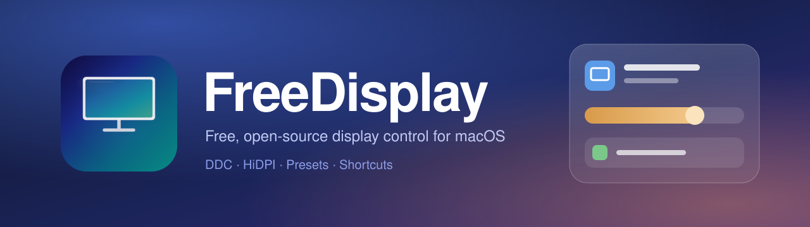
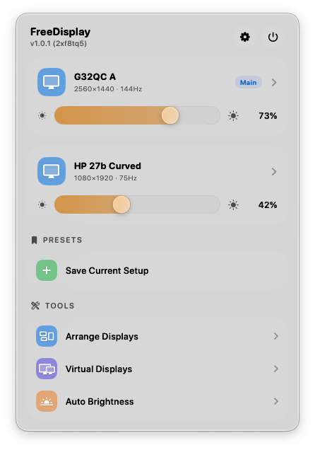
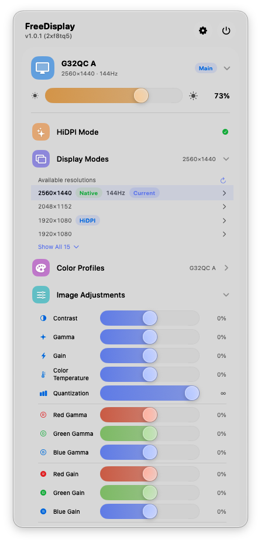
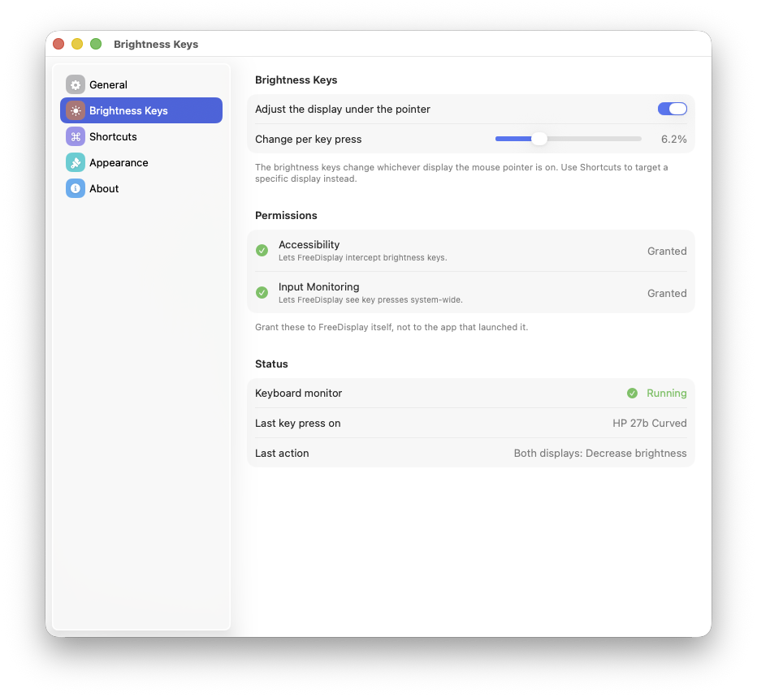
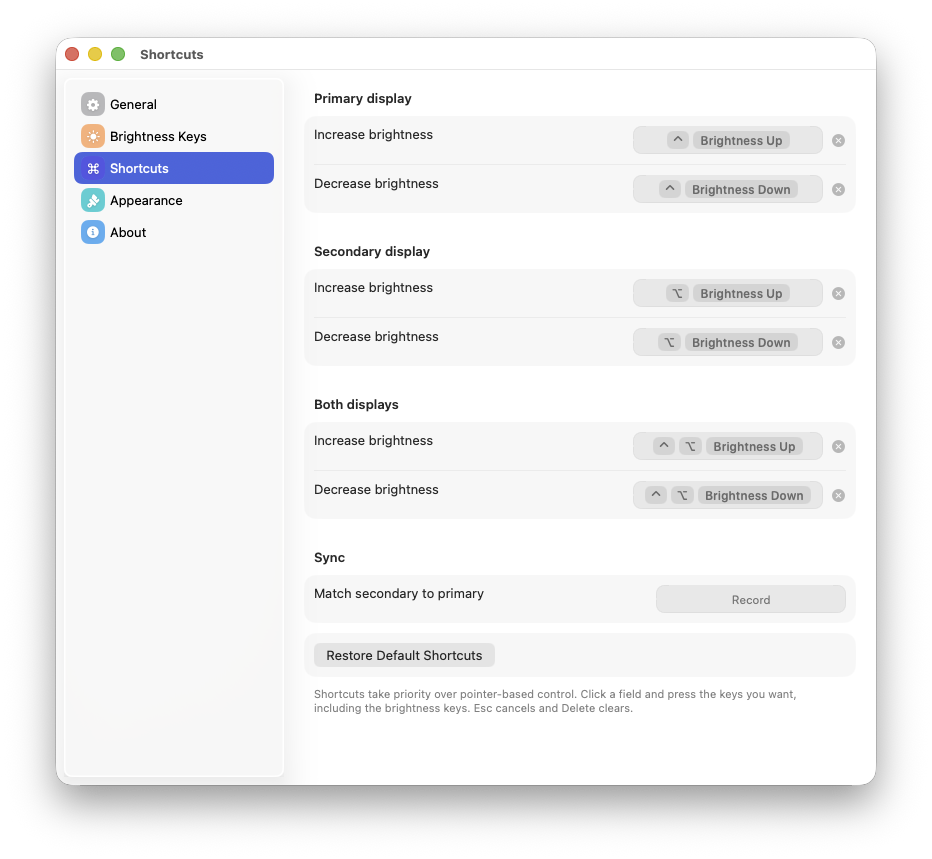
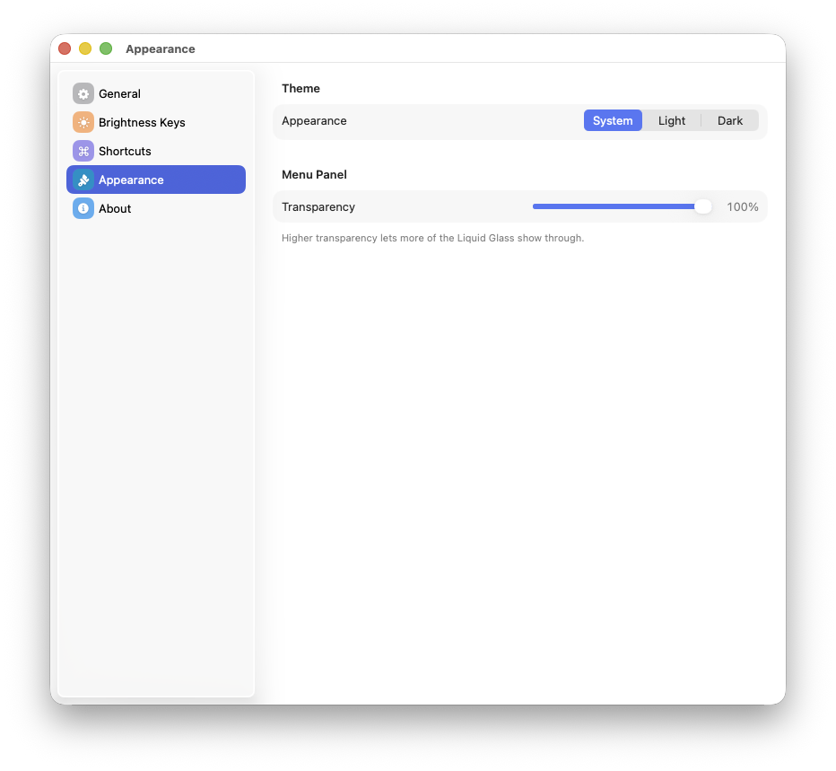

<p align="center">
  
</p>

<p align="center">
  <a href="https://github.com/teezyyoxo/FreeDisplay/releases/latest"></a>
  
  
  
</p>

<p align="center">
  <b>A free, open-source menu bar app for managing your displays.</b><br>
  Hardware brightness, HiDPI, resolutions, color profiles, presets, and keyboard shortcuts.
</p>

<p align="center">
  <a href="https://github.com/teezyyoxo/FreeDisplay/releases/latest"><b>Download</b></a> ·
  <a href="#features">Features</a> ·
  <a href="#installation">Install</a> ·
  <a href="https://github.com/teezyyoxo/FreeDisplay/issues">Report an issue</a>
</p>

> **Credit:** FreeDisplay was created by [**huberdf**](https://github.com/huberdf). This repository is a fork maintained by [teezyyoxo](https://github.com/teezyyoxo). It adds a redesigned Liquid Glass interface, configurable brightness shortcuts, a Settings window, and a number of fixes. The original app, its architecture, and its DDC and HiDPI groundwork are huberdf's work. See the [original repository](https://github.com/huberdf/FreeDisplay).

---

## Why FreeDisplay?

[BetterDisplay](https://github.com/waydabber/BetterDisplay) is a great app, but its best features sit behind a paid Pro license. FreeDisplay implements the essentials as a free menu bar app with no third-party dependencies and no account.

## Screenshots

<table>
  <tr>
    <td align="center" width="50%">
      <br>
      <sub><b>One panel for every display.</b> Per-display brightness, presets, and tools.</sub>
    </td>
    <td align="center" width="50%">
      <br>
      <sub><b>Everything per display.</b> HiDPI, resolutions tagged Native or HiDPI, color profiles, and image adjustments.</sub>
    </td>
  </tr>
</table>

### Settings

<table>
  <tr>
    <td align="center" width="33%">
      <br>
      <sub><b>Brightness Keys</b></sub>
    </td>
    <td align="center" width="33%">
      <br>
      <sub><b>Shortcuts</b></sub>
    </td>
    <td align="center" width="33%">
      <br>
      <sub><b>Appearance</b></sub>
    </td>
  </tr>
</table>

---

## Features

### Brightness

- **Hardware brightness and contrast (DDC/CI)** for external displays, over IOKit I2C on Intel and IOAVService on Apple Silicon.
- **Software brightness** through per-display gamma tables, with smooth transitions.
- **Brightness keys for external displays.** The keys adjust the display under the mouse pointer, with the native macOS on-screen indicator. They work with media keys and with keyboards that send F14 and F15.
- **Custom shortcuts** for the primary display, the secondary display, both displays, and "match secondary to primary".
- **Auto brightness** that follows the built-in display's brightness.

### Resolution and HiDPI

- Browse and switch every display mode, each tagged **Native** or **HiDPI**.
- **HiDPI** through display override plists, plus virtual HiDPI displays.
- **Display arrangement.** Drag displays into position.
- **Virtual (dummy) displays** for headless setups.

### Color and image

- **ICC color profiles** per display, through ColorSync.
- **Image adjustments.** Contrast, gamma, gain, color temperature, quantization, and per-channel RGB.
- **Notch management.** Hide the MacBook notch with a black overlay.

### Everything else

- **Presets.** Save and restore a full display setup with one click.
- **Liquid Glass interface** on macOS 26 and later, with a blur material fallback on macOS 14 and 15. Choose System, Light, or Dark.
- **Launch at login** and optional update checks.

### Not included

- Screen streaming and picture-in-picture
- EDID override, which requires SIP to be disabled
- XDR and HDR extra brightness, which requires specific hardware

---

## Installation

### Download

1. Download `FreeDisplay-v1.0.1.zip` from [Releases](https://github.com/teezyyoxo/FreeDisplay/releases/latest).
2. Unzip it and move **FreeDisplay.app** to **Applications**.
3. On first launch, right-click the app and choose **Open**. The build is ad-hoc signed and not notarized, so macOS asks for approval once.

macOS may ask you to grant the permissions below again after you update, because an ad-hoc signature changes with each build.

### Build from source

```bash
brew install xcodegen
git clone https://github.com/teezyyoxo/FreeDisplay.git
cd FreeDisplay
xcodegen generate
xcodebuild -scheme FreeDisplay -configuration Release build
```

Builds are ad-hoc signed by default. To sign with your own identity, create `Config/Local.xcconfig`. It is gitignored and overrides the defaults:

```
CODE_SIGN_IDENTITY = <your certificate name or SHA-1>
DEVELOPMENT_TEAM = <your team ID>
```

Running `./build.sh` also builds a DMG, exporting ad-hoc signed by default. A gitignored `ExportOptions.local.plist` overrides the export options.

---

## Permissions

| Permission | Why |
|------------|-----|
| **Accessibility** | Intercept brightness keys and shortcuts |
| **Input Monitoring** | See key presses system-wide |

Grant both to FreeDisplay itself, not to the app that launched it. **Settings → Brightness Keys** shows whether each is granted.

FreeDisplay needs no internet connection. The only network request is the optional update check against the GitHub Releases API.

---

## How it works

- **External monitors:** DDC/CI over I2C (Intel) or IOAVService (Apple Silicon) controls hardware brightness, contrast, and more.
- **Built-in display:** CoreGraphics gamma tables provide software brightness.
- **Brightness keys:** a CGEventTap intercepts the keys and routes them to the display under your pointer.
- **Auto brightness:** the built-in display's brightness is read through the CoreDisplay private API, and external displays follow it proportionally.
- **HiDPI:** display override plists give persistent HiDPI modes. A replug is needed before macOS loads them.

## Tech stack

- **Swift 6** and **SwiftUI** (`MenuBarExtra`), with AppKit where needed
- **IOKit** for DDC/CI
- **CoreGraphics** for enumeration, resolution, and arrangement
- **ColorSync** for ICC profiles
- **CGVirtualDisplay** and **CoreDisplay** (private APIs, loaded at runtime)
- No third-party dependencies

## Project structure

```
FreeDisplay/
├── App/        # AppDelegate and app entry point
├── Models/     # DisplayInfo, DisplayMode, DisplayPreset, ShortcutBinding
├── Services/   # DDC, brightness, gamma, resolution, HiDPI, shortcuts, and more
└── Views/      # Menu panel, Settings window, shared glass design system
```

## Contributing

Issues and pull requests are welcome.

- Edit `project.yml`, not the `.xcodeproj`, then run `xcodegen generate`.
- Swift 6 with `SWIFT_STRICT_CONCURRENCY: minimal`.
- MVVM: View → ViewModel → Service.
- Keep personal signing details in `Config/Local.xcconfig`, never in tracked files.

---

## License

The original project's README declares the MIT License, and this fork keeps it. The original repository does not currently include a `LICENSE` file, so see [huberdf/FreeDisplay](https://github.com/huberdf/FreeDisplay) for the author's terms. Original work © huberdf.

## Acknowledgments

- **[huberdf](https://github.com/huberdf)**, creator of [FreeDisplay](https://github.com/huberdf/FreeDisplay), the project this fork builds on
- Inspired by [BetterDisplay](https://github.com/waydabber/BetterDisplay), [MonitorControl](https://github.com/MonitorControl/MonitorControl), and [Lunar](https://lunar.fyi/)
- The CGVirtualDisplay bridging header is based on [Chromium's virtual_display_mac_util.mm](https://chromium.googlesource.com/chromium/src/+/main/ui/display/mac/test/virtual_display_mac_util.mm)
